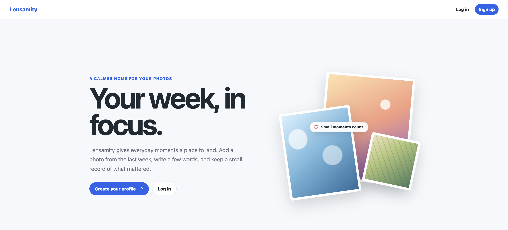

# Lensamity

Lensamity is an online photo journal built around taking one photo a day to capture the moments that matter. Add photos from the past week, give them a title and description, and build your own gallery. You can share your photos with signed-in users or keep them private. Lensamity was built as a final project for the [University of Helsinki's Full Stack Open MOOC](https://www.helsinki.fi/en/admissions-and-education/open-university/multidisciplinary-themed-modules/full-stack).

## Try it

This learning project is hosted on free plans from Render and Neon, using PostgreSQL and S3-compatible storage. Try the live website at [lensamity.onrender.com](https://lensamity.onrender.com/). The site may take a moment to load after a period of inactivity, so please wait for it to finish loading.

1. [Open the live app](https://lensamity.onrender.com/) and select **Sign up** to create an account.
2. Open the account menu and select **Add photo**. Choose a JPEG, PNG, or WebP image up to 10 MiB, then select a date within the last seven days.
3. Add a title and description, upload the photo, and open **Profile** to see your gallery.
4. Open **Settings** to edit your profile, change its visibility, or update your avatar.

Each account can have one active photo per date. You need to sign in to view profiles and photos. By default, profiles are public to signed-in members of the Lensamity community.

## Features

- Account registration, login, and logout with server-side cookie sessions.
- Photo uploads with a date rule, upload completion checks, and owner-controlled deletion.
- Profile galleries with pagination and individual photo pages.
- Profile editing, public/private visibility, and avatar cropping, replacement, and deletion.
- Username and password changes, session revocation on password changes, and account deletion.
- Scheduled session cleanup and queued object-storage deletion.

## Technology and design

| Area | Tools |
| --- | --- |
| Web client | React, TypeScript, Vite, React Router, plain CSS |
| Client data | TanStack Query, Zustand, Axios |
| API | Go, standard-library `net/http`, structured logging |
| Data | PostgreSQL, pgx, sqlc, Goose migrations |
| Authentication | Argon2id password hashing, HttpOnly cookie sessions |
| Images | S3-compatible storage, presigned uploads |
| Infrastructure | Docker Compose and RustFS locally; Render and Neon for deployment |
| Checks and releases | Biome, Go formatting/vet/tests, GitHub Actions |

The browser uploads image files directly to object storage using a short-lived presigned request. The Go API manages metadata, permissions, and upload completion. See the [architecture guide](docs/architecture.md) for more about the request flow and data model.

## Documentation

| File | Description |
| ----- | ----------- |
| [User guide](docs/user-guide.md) | Short instructions with screenshots for using the app. |
| [Architecture guide](docs/architecture.md) | Application structure, request flow, and data model. |
| [API reference](docs/api.md) | Endpoints, request and response formats, and sequence diagrams. |
| [Local development](docs/development.md) | Environment setup and commands to run the app locally. |
| [Work hours listing](docs/work-hours-listing.md) | Development log with task descriptions and total hours spent. |

## AI use

I used Codex (5.5 and 6.1 Sol) and GitHub Copilot to draft documentation, learn more about the technologies in this project, review code, and generate some source files. I mark source files generated entirely or almost entirely by AI with a comment at the top.
