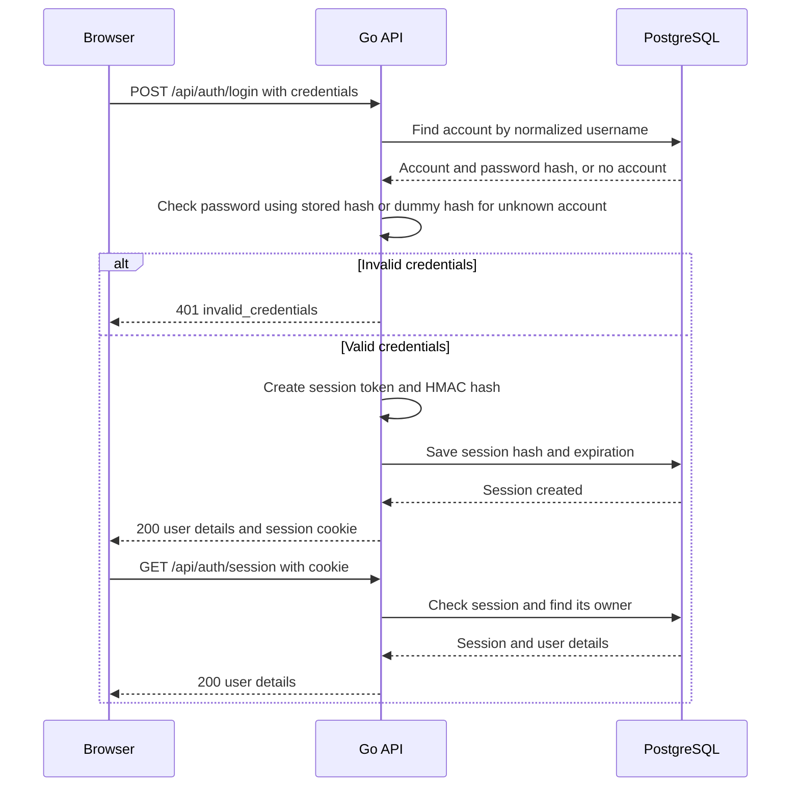
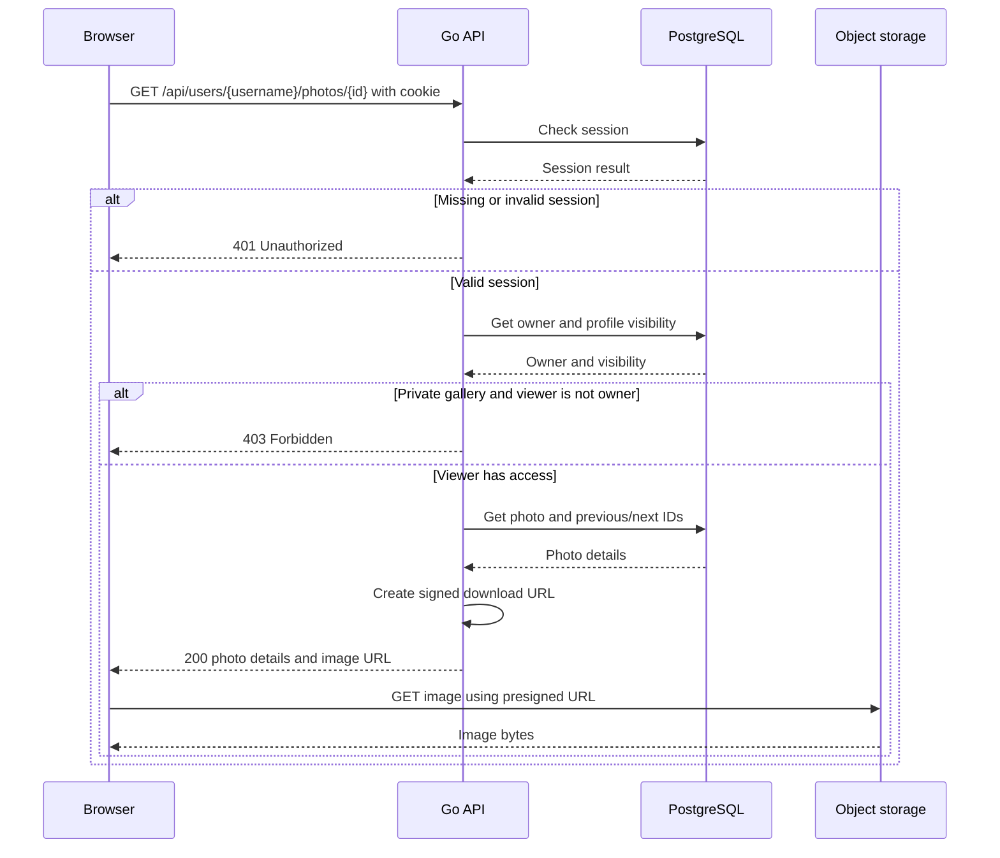
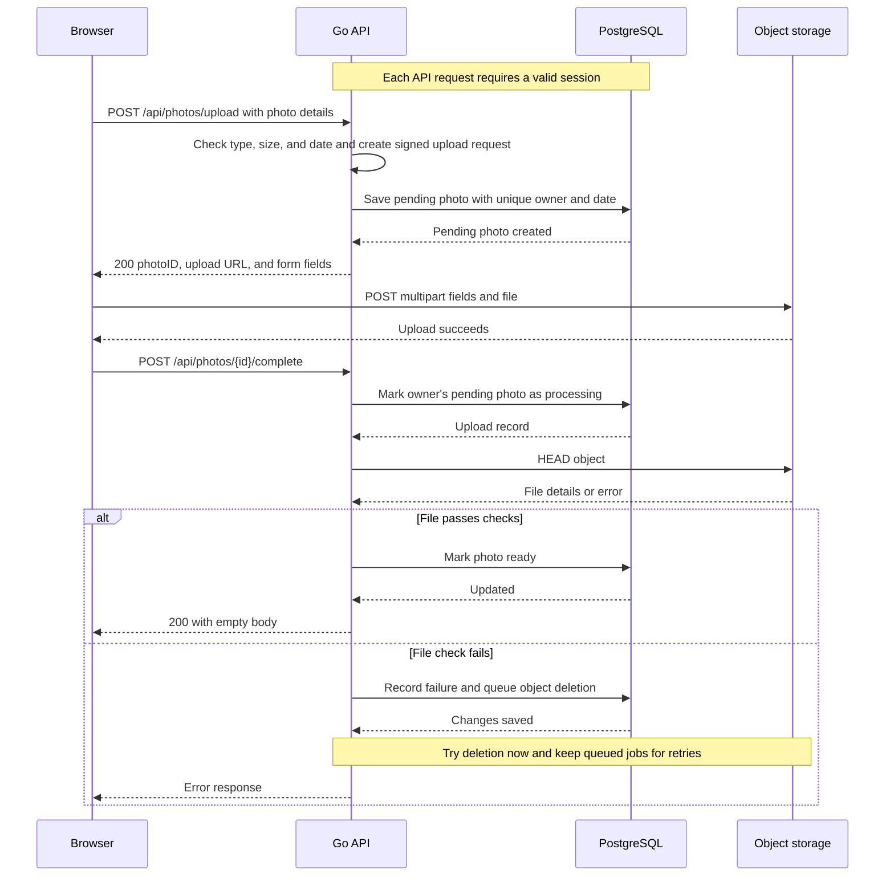

# API reference

This guide lists the API endpoints and shows how the main requests work. See the [routes](../server/cmd/api/main.go), [handlers](../server/internal/handler/), and [architecture guide](architecture.md) for more detail.

## Basics

- Live app: `https://lensamity.onrender.com`.
- Local app through Nginx: `http://localhost:8080`.
- API paths start with `/api`. The health check uses `/health`.
- Send JSON with `Content-Type: application/json`. Upload image files separately to the storage URL returned by the API.
- `{username}` is the account username. Photo and avatar upload IDs are UUIDs.
- Data responses use JSON. `204` responses and successful upload-completion responses have no body.

## Authentication

Login sets a `session` cookie with `HttpOnly`, `Secure`, and `SameSite=Lax`. Send this cookie with API requests. Do not send it with direct storage uploads. The API does not use bearer tokens.

All endpoints require login unless marked public. Viewing public profiles also requires login. A missing or invalid session returns `401`; a session lookup failure can return `500`.

### Authentication endpoints

| Method | Path | Access | Request | Success |
| --- | --- | --- | --- | --- |
| POST | `/api/auth/signup` | Public | JSON: `username`, `password`, optional `displayName` | `201` with `username` and `displayName`; login is a separate step |
| POST | `/api/auth/login` | Public | JSON: `username`, `password` | `200` with `username`, `displayName`, and a session cookie |
| POST | `/api/auth/logout` | Public; uses cookie if present | No body | `204`; ends the session and clears the cookie; also works without a cookie |
| POST | `/api/auth/logout-all` | Session | No body | `204`; ends all user sessions and clears the cookie |
| GET | `/api/auth/session` | Session | No body | `200` with the signed-in user's `username` and `displayName` |
| GET | `/api/auth/username-availability` | Public | Required query parameter: `username` | `200` with `isAvailable` and optional `validationError` |

Usernames are normalized and must be 3–32 characters: Latin letters, numbers, underscores, or hyphens. Reserved and taken names cannot be used. Display names must be 3–32 characters; signup uses the username if no display name is given. Passwords must contain 15–128 printable characters and pass the strength check.

Signup returns `400` for invalid input or `409` for an unavailable username. Login returns `400` for a bad request or `401` for incorrect credentials. The availability check returns `400` if `username` is missing; invalid names can return `200` with `validationError`.

Example login request:

```http
POST /api/auth/login
Content-Type: application/json
```

```json
{
  "username": "photojournal",
  "password": "<your-password>"
}
```

Example login or session response:

```json
{
  "username": "photojournal",
  "displayName": "Photo Journal"
}
```

### Login sequence

The diagrams leave out Nginx and internal code layers to keep the flows clear.



## Profiles and account settings

| Method | Path | Request | Success |
| --- | --- | --- | --- |
| GET | `/api/users/{username}` | No body | `200` with the profile response below |
| PUT | `/api/users/me/profile` | JSON: `displayName`, `visibility`, optional `about` | `204` after saving the profile |
| PUT | `/api/users/me/username` | JSON: `newUsername` | `200` with `updatedUsername` |
| PUT | `/api/users/me/password` | JSON: `oldPassword`, `newPassword`, optional `revokeAll` | `204` with a replacement session cookie |
| DELETE | `/api/users/me` | No body | `204`; deletes the account, clears the cookie, and queues file cleanup |

The `/me` routes change your own account. Set `visibility` to `public` or `private`. The `about` text can be up to 300 characters; leaving it out clears it. Invalid profile values return `400`.

New usernames follow the signup rules. Invalid or taken names return `400`. Changing your username changes your profile address.

To change a password, provide the current password and a different valid new password. With `revokeAll: true`, all sessions end and the current browser gets a new session. Otherwise, only the current session is replaced. The web UI sends `true`. Invalid passwords return `400`; a password changed by another request can return `409`.

Profile response fields:

| Field | Type | Meaning |
| --- | --- | --- |
| `username`, `displayName` | string | Account username and display name |
| `photoCount` | integer | Number of ready photos |
| `canEdit` | boolean | You own this profile |
| `canViewPhotos` | boolean | You can view its photos |
| `visibility` | string | `public` or `private` |
| `joinedAt` | timestamp string | Account creation time |
| `about` | string, optional | Profile description, omitted if empty |
| `avatar` | object, optional | Temporary image link with `url`, `method`, and `header` |

Private visibility hides photos, but signed-in users can still see basic profile details and the avatar. A missing profile returns `404`. Deleting an account removes its records; stored files may be deleted later.

## Photo viewing and pagination

| Method | Path | Request | Success |
| --- | --- | --- | --- |
| GET | `/api/users/{username}/photos` | Optional query parameters: `limit`, `cursor` | `200` with gallery permissions and a page of photos |
| GET | `/api/users/{username}/photos/{id}` | No body | `200` with `photo` and optional `previousPhotoID` / `nextPhotoID` |

`limit` defaults to 24 and must be a positive integer. Values above 100 are reduced to 100. To load more photos, send the returned `nextCursor` as `cursor` without changing it. No `nextCursor` means there are no more pages. Invalid limits return `400`; invalid cursors currently return `500`.

The response contains `canEdit`, `canViewPhotos`, `photoCount`, `items`, and optional `nextCursor`. Here, `photoCount` counts this page's items. An empty gallery returns `items: []`. A private gallery viewed by a non-owner returns `200` with `canViewPhotos: false`, `photoCount: 0`, and `items: null`.

Each photo contains:

```json
{
  "photoID": "<photo-uuid>",
  "title": "Morning light",
  "description": "A quiet start to the day.",
  "date": "2026-11-06",
  "request": {
    "url": "<presigned-download-url>",
    "method": "GET",
    "header": {},
    "isReady": true
  }
}
```

Dates use `YYYY-MM-DD`. `header` holds signed request headers, with arrays of strings as values; `{}` is just an example. A gallery item can have `isReady: false` when no image request is available.

Opening someone else's private photo returns `403`. Invalid photo IDs return `400`; missing photos return `404`. Other error responses vary between these endpoints; see the handlers for details.

### Protected photo access sequence



Storage checks the URL signature, not the login session. Download URLs currently last 15 minutes and can still work after a profile becomes private. `ResponseExpires` controls the HTTP caching header, not the signature lifetime. The API checks access before returning a fresh URL.

## Photo upload and deletion

| Method | Path | Request | Success |
| --- | --- | --- | --- |
| POST | `/api/photos/upload` | Upload-intent JSON described below | `200` with `photoID`, `url`, `method`, and `formDataValues` |
| POST | `/api/photos/{id}/complete` | No body | Empty `200`; checks the stored file and marks the photo ready |
| DELETE | `/api/photos/{id}` | No body | `204`; marks your photo deleted and queues file cleanup |

First, request an upload link:

```json
{
  "date": "06-11-2026",
  "contentType": "image/jpeg",
  "size": 245760,
  "title": "Morning light",
  "description": "A quiet start to the day."
}
```

- `date` must use `DD-MM-YYYY` and be today or one of the previous six days in UTC. Update the example date before using it.
- `contentType` must be `image/jpeg`, `image/png`, or `image/webp`.
- `size` is the exact file size in bytes: greater than zero and no more than 10 MiB (10 × 1024 × 1024 bytes).
- `title` and `description` are optional. The database limits them to 120 and 2,000 characters. The handler does not yet return specific validation errors for these limits.
- Each account can have one active photo/upload per date. A date already in use returns `409 photo_already_exists`.

Invalid dates or types return `400`; a file over the size limit returns `413`.

Next, copy every `formDataValues` entry into `FormData` unchanged, add the file as `file`, and POST it to the returned storage URL. Let the browser set the multipart boundary.

After the file upload succeeds, call the completion endpoint. It checks that the file exists and its size and declared type match the record. It does not yet decode or process the photo bytes.

Completion errors include `400` for an invalid ID, `404` for a missing upload/photo, `409` when the photo cannot be completed, `413` for excessive size, and `415` for unsupported type. Other failures can return `500` or `504`.

### Photo upload sequence



Photo and avatar upload links last ten minutes. Daily detection of abandoned uploads is planned but not implemented; see the architecture guide.

## Avatar upload and deletion

| Method | Path | Request | Success |
| --- | --- | --- | --- |
| POST | `/api/users/me/avatar/uploads` | JSON: `contentType`, `size` | `200` with `uploadID`, `url`, `method`, and `formDataValues` |
| POST | `/api/users/me/avatar/uploads/{id}/complete` | No body | Empty `200`; sets the current avatar and handles old-file cleanup |
| DELETE | `/api/users/me/avatar` | No body | `204`; removes the avatar and queues file cleanup |

Follow the photo upload flow, using the returned `uploadID` to complete the avatar upload. Use JPEG, PNG, or WebP, up to 1 MiB. Completion returns `404` for an expired or missing upload.

Avatar completion checks the image bytes too. It returns `422` for invalid images, dimensions over 4,096 pixels, more than 16 million pixels, or a width-to-height ratio over 3:1 in either direction. Size/type errors return `413`/`415` during completion. The initial upload request uses `400` for unsupported types and `413` for excessive size.

## Health

`GET /health` is public and returns `200`:

```json
{
  "status": "healthy",
  "time": "2026-11-06T10:00:00Z"
}
```

`time` is the current request time. This checks that the HTTP handler runs, not whether the database or storage is reachable.

## Errors and notes

Handlers using `WriteError` return JSON:

```json
{
  "error": {
    "code": "date_out_of_range",
    "message": "date must be within the last 7 days including today"
  }
}
```

Some middleware and user handlers return plain text instead, including some `401`, `403`, `404`, and `500` errors. Check the HTTP status and handle both formats.

Most JSON request bodies have an 8 KiB limit and reject unknown fields. Image limits are separate because files go directly to storage. Database or storage failures may return `500`; authentication and upload timeouts return `504`.

`/session-cleanup` and `/storage-cleanup` run in a separate Neon function. They are not Go API routes for the browser.
