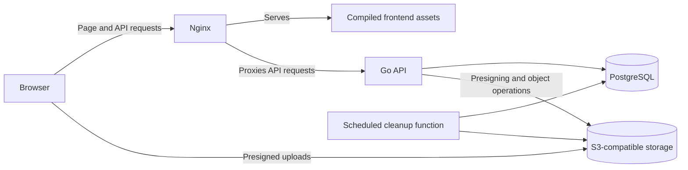

<!-- This document was generated by AI based on the project codebase and the author's instructions, then reviewed by the author. -->

# Architecture

Lensamity consists of a React web client, a Go HTTP API, a PostgreSQL database, and S3-compatible image storage. The API handles authentication, permissions, and photo metadata. The browser transfers image files directly to storage using presigned requests issued by the API.

## System overview



This diagram shows the production arrangement. In local development, Nginx proxies the Vite development server instead of serving compiled frontend assets. PostgreSQL stores application data and object locations; image bytes live in object storage.

## Frontend

The client is built with React and TypeScript. Its code is organized around pages, features, hooks, and API services.

| Location | Responsibility |
| --- | --- |
| [`client-web/src/App.tsx`](../client-web/src/App.tsx) | Routes for authentication, profiles, photo pages, uploads, and settings |
| `client-web/src/pages/` | Page components and route-level composition |
| `client-web/src/features/` | UI grouped by authentication, profiles, photos, and settings |
| `client-web/src/hooks/` | Reusable fetching, mutation, and interaction logic |
| `client-web/src/services/` | Typed API requests and direct storage uploads |
| [`client-web/src/stores/auth.ts`](../client-web/src/stores/auth.ts) | Current-user state and authentication actions |

React Router maps URLs to pages. TanStack Query manages fetched data, caching, pagination, and mutations. Zustand stores the current user's identity and authentication-related actions. Axios handles HTTP requests.

The client persists the username and display name in localStorage. The session credential is held in an HttpOnly cookie. On startup, the client checks the session with the API. An unauthorized response from the protected API client clears cached data and local authentication state and redirects to login.

Client route protection controls navigation. The API independently validates authentication and access permissions for protected requests.

## Backend

The Go API uses the standard-library `net/http` server and router. Its entry point constructs dependencies, registers routes, and configures request logging, timeouts, and graceful shutdown.

Most domain requests follow this path:

```text
HTTP request → middleware → handler → service → repository → database or storage
```

| Package or location | Responsibility |
| --- | --- |
| [`server/cmd/api/main.go`](../server/cmd/api/main.go) | Dependency construction, routing, and server lifecycle |
| `server/internal/middleware/` | Session authentication and request logging |
| `server/internal/handler/` | Request decoding, request deadlines, and HTTP responses |
| `server/internal/auth/` | Credential validation, password hashing, and session management |
| `server/internal/users/` | Profile access, gallery queries, and account/profile changes |
| `server/internal/uploads/` | Photo and avatar upload lifecycles and deletion |
| `server/internal/storage/` | S3 clients and shared object-deletion helpers |
| `server/internal/db/` | Database store and sqlc-generated query code |

User and upload services delegate data access to repositories. Authentication currently calls generated database queries directly. SQL source files live in `server/sqlc/`; sqlc generates the corresponding Go query methods. Goose migrations are embedded in a separate migration command.

## Database design

| Table | Stored information |
| --- | --- |
| `users` | Unique username, display name, password hash, about text, and profile visibility |
| `sessions` | Hashed session credential, owner, activity timestamps, expiration, and revocation |
| `photos` | Owner, photo date, title, description, object location, and upload status |
| `user_avatars` | Current avatar metadata, with at most one row per user |
| `avatar_uploads` | Avatar upload attempts, object locations, and lifecycle state |
| `storage_deletion_jobs` | Objects awaiting deletion, retry times, claims, and completion information |

The migration files in []../server/migrations/sql/](../server/migrations/sql/) define the exact schema, indexes, and constraints.

## Photo upload and viewing

Uploading is split into an intent request, a direct storage upload, and a completion request:

1. The signed-in browser calls `POST /api/photos/upload` with the date, declared file type and size, title, and description.
2. The API validates the request, creates a pending photo record, and returns a presigned POST request and photo ID.
3. The browser sends the file and returned form fields directly to object storage.
4. After the storage request succeeds, the browser calls `POST /api/photos/{id}/complete`.
5. The API moves the pending record into processing and checks that the stored object's size and declared content type match the upload record.
6. A successful completion marks the photo ready. A failed completion records a failure and queues the object for deletion where applicable.
7. **Planned:** a scheduled function will check for abandoned photo and avatar uploads once a day, mark expired uploads as expired, and queue their stored files for deletion. See issue [ Clean up abandoned photo and avatar uploads daily (#33)](https://github.com/ipersids/lensamity-app/issues/33).

Photo uploads accept JPEG, PNG, and WebP files up to 10 MiB. The selected date must be today or one of the previous six days, evaluated in UTC. Upload requests are presigned for ten minutes.

When a gallery or photo page is requested, the API checks access and returns metadata with presigned download URLs. The browser then loads images directly from storage. Individual photo responses also include previous/next photo IDs for navigation.

Avatar uploads use a similar intent-and-completion flow. The client provides cropping and zoom controls. The API limits avatars to 1 MiB and inspects image data, dimensions, pixel count, and aspect ratio before accepting a completed upload.

Relevant implementation: [photo service](../server/internal/uploads/photo.go), [client upload service](../client-web/src/services/photo.ts), and [user service](../server/internal/users/users.go).

## Authentication and permissions

Passwords are hashed with Argon2id – the recommended hybrid password hashing algorithm that won the 2015 Password Hashing Competition and is standardized in `RFC 9106`. A successful login generates a random session token and stores its `HMAC-SHA256` hash in PostgreSQL. The raw token is returned in the `session` cookie, which uses `HttpOnly`, `Secure`, and `SameSite=Lax`.

For protected requests, authentication middleware hashes the cookie token and looks up its session. The session must be unrevoked, within its seven-day absolute lifetime, and within its 36-hour idle timeout. Activity timestamps are updated at intervals of at least 15 minutes to reduce database writes.

Logout revokes the current session. The API also supports revoking all sessions. Password changes create a replacement session; the current UI requests revocation of all existing sessions during that change.

All profile and photo read routes currently require login. A public profile's photos are available to signed-in users, while a private profile's photos are restricted to its owner. Private visibility does not hide the basic profile metadata or avatar returned by the profile endpoint. Backend operations also check ownership before changing or deleting user content.

Presigned image URLs grant temporary access to their objects (default 15 minutes). A previously issued URL can remain usable until it expires, even if the profile's visibility changes.

Relevant implementation: [authentication service](../server/internal/auth/auth.go), [session tokens](../server/internal/auth/sessions.go), and [authentication middleware](../server/internal/middleware/auth.go).

## Deletion and background work

Database changes and object-storage deletion are separate operations. Deletion flows record storage jobs in the database transaction so that a storage failure does not lose the information needed to retry cleanup.

After committing database changes, the API attempts immediate object deletion. If deletion or job completion fails, queued work remains available for retry. Jobs can also delay the scheduled attempt until after the upload window and a short buffer.

The scheduled cleanup function claims due deletion jobs, deletes objects in batches, and records each result. Failed jobs receive a later retry time. Claims expire so another invocation can recover work left by an interrupted run. The cleanup function also removes old completed-job records.

[`neon.ts`](../neon.ts) defines two daily schedules: session cleanup (`0 3 * * *`) and storage cleanup (`0 4 * * *`). Session cleanup removes sessions whose absolute expiration or revocation is more than three days old; expired sessions are rejected by the API before physical cleanup. The schedules use the platform's configured time zone. These functions are separate from the local Docker Compose stack.

Relevant implementation: [storage cleanup helper](../server/internal/storage/cleanup.go), [deletion-job queries](../server/sqlc/jobs.sql), and [scheduled cleanup function](../neon/functions/cron-cleanup.ts).

## Deployment

| Environment | Components |
| --- | --- |
| Local development | Docker Compose runs Nginx, Vite, the Go API with Air, PostgreSQL, and RustFS |
| Production | Render runs the frontend/API container; Neon provides PostgreSQL and S3-compatible storage, with cleanup functions configured separately |

The [production Dockerfile](../prod.Dockerfile) builds the frontend and Go API in separate build stages, then packages them into an Nginx image. Nginx listens on port 10000, serves the compiled client, and proxies `/api/` and `/health` to the API on port 8080. Other frontend paths fall back to `index.html` so client routes can load directly.

GitHub Actions runs code-quality checks, Go tests, and a production image build. The release-preparation workflow creates a version tag and draft release. Publishing a non-prerelease release triggers the Render deployment workflow for the tagged commit.

Database migrations are run with the separate migrator. The production container startup does not apply them automatically, and cleanup-function deployment is separate from the Render image. Database credentials, session secrets, and storage credentials are supplied through environment configuration.

## Design tradeoffs

| Choice | Benefit | Cost or constraint |
| --- | --- | --- |
| Direct uploads to storage | Image bytes bypass the API server | Upload intent, transfer, and completion need separate failure handling |
| Server-side sessions | Sessions can be revoked through database state | Protected requests need a session lookup |
| SQL queries with sqlc | Explicit SQL produces typed Go access methods | Query and schema changes require keeping generated code in sync |
| Cursor pagination | Galleries can load additional pages using a stable date-and-ID ordering | The cursor must be carried between requests; arbitrary page-number navigation is not provided |
| Queued storage deletion | Failed object deletions can be retried after database changes commit | Physical removal can happen later than removal from the application |
| One frontend/API container | Nginx serves the UI and API through one origin | Frontend and API releases are coupled |

## Current limitations

See some known limitations and its status in issue [[ docs ] Current limitations #34](https://github.com/ipersids/lensamity-app/issues/34)
