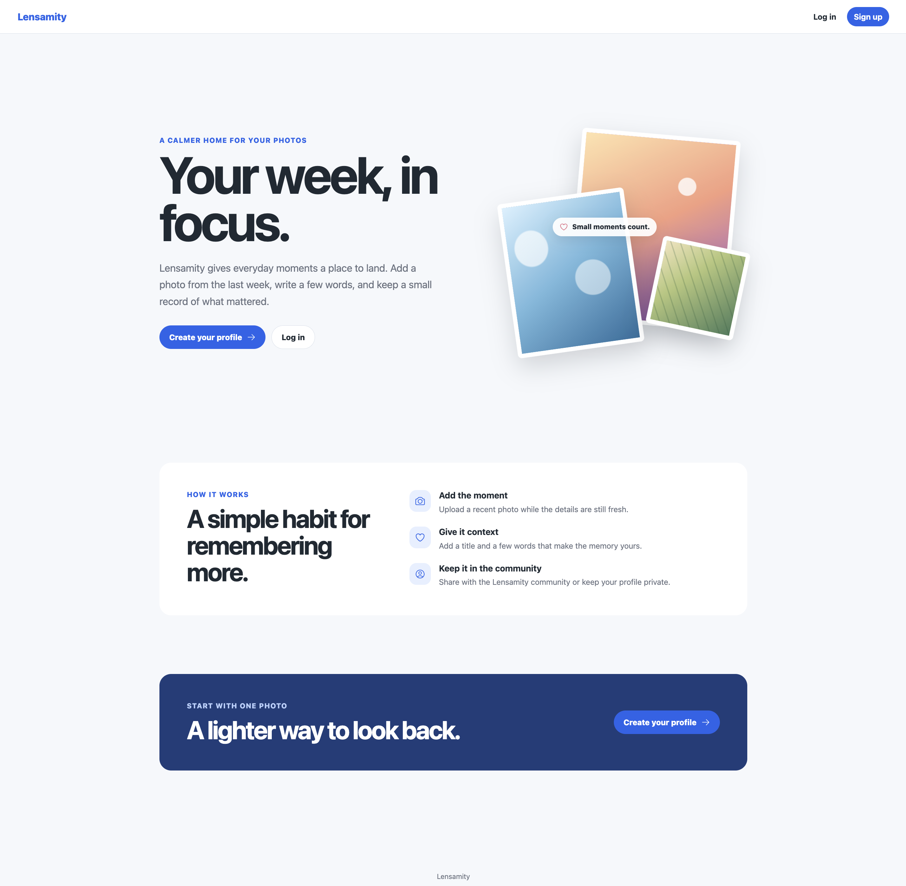
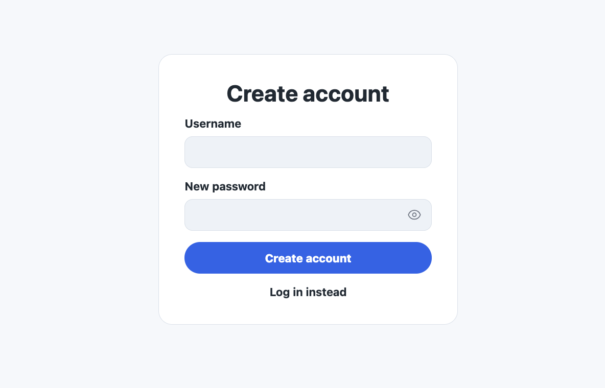
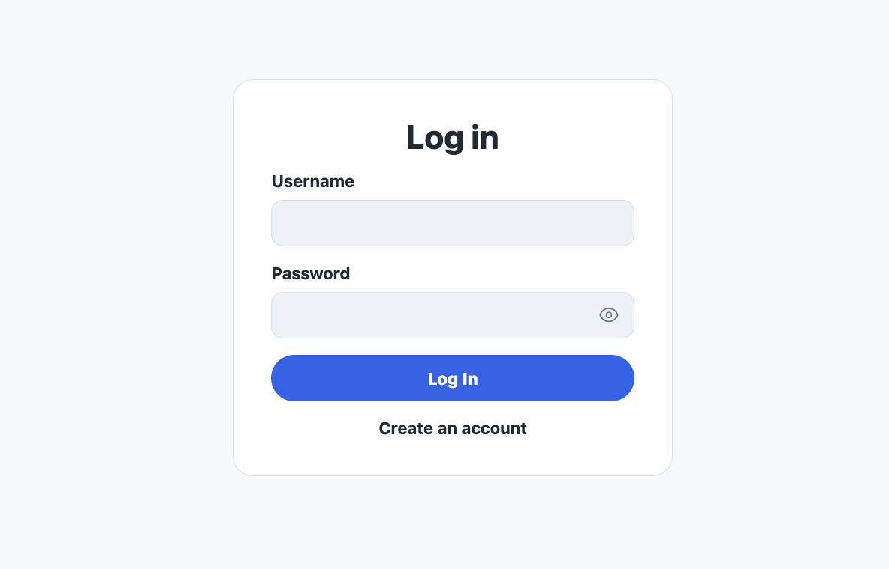
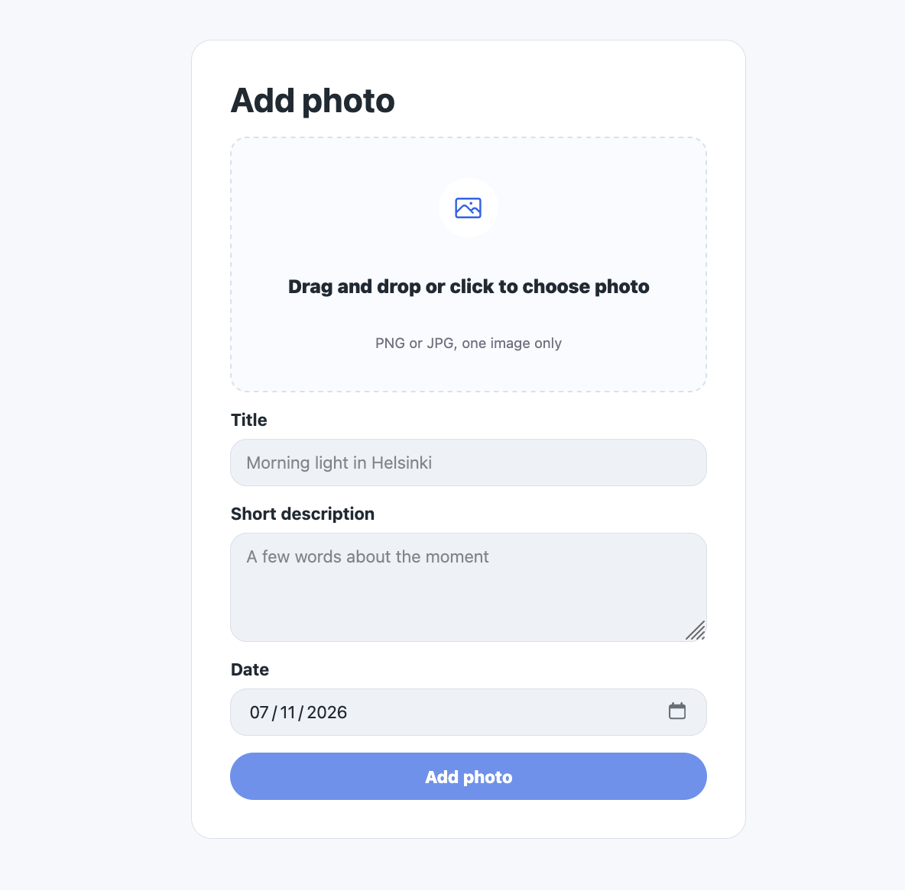
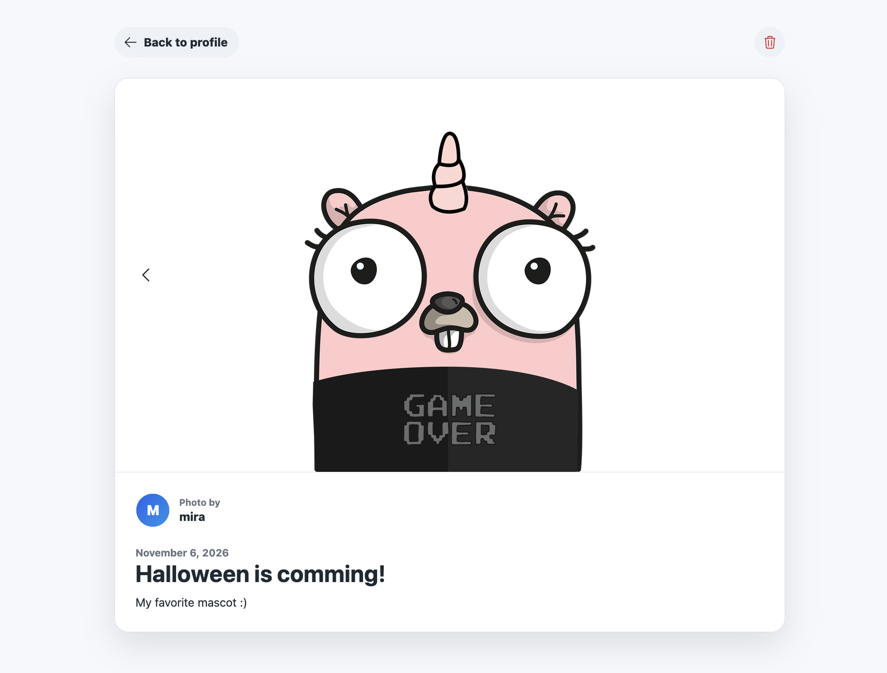
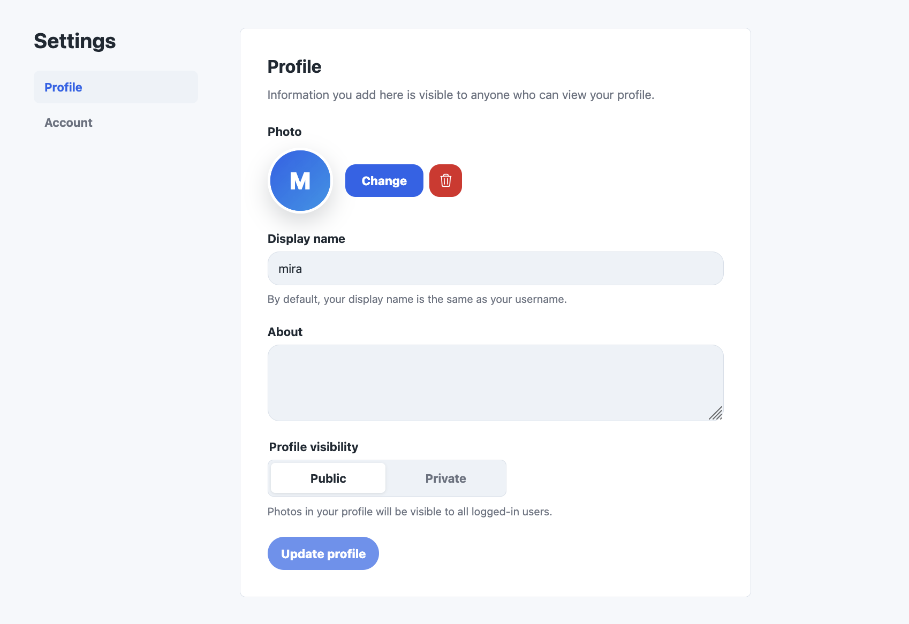
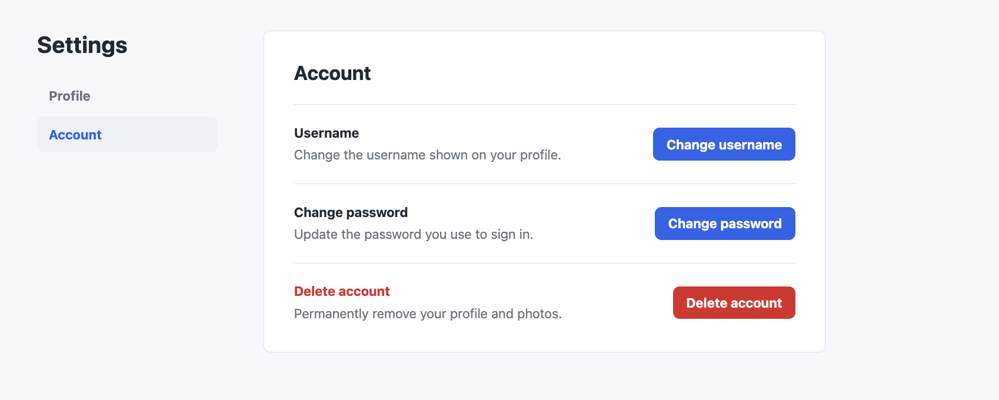

# User guide

Lensamity is a photo journal for everyday moments.

## 1. Create an account

Select **Sign up**, enter a username and password, and select **Create account**. Use a password with at least 15 characters and follow the validation feedback. After registration, the app takes you to the login page.

## 2. Log in

Enter your username and password, then select **Log In**. Click your name in the header to open the account menu. From there, you can open **Profile**, **Add photo**, or **Settings**, or select **Log out**.

## 3. Add a photo

1. Open **Add photo** from the account menu.
2. Click the upload area or drag an image onto it. Choose a JPEG, PNG, or WebP file up to 10 MiB.
3. Add a title and short description.
4. Choose today or one of the previous six days. Each account can have one active photo per date. The server checks dates in UTC.
5. Select **Add photo** to upload it and open its photo page.

## 4. View and delete photos

Open **Profile** to see your gallery and select a photo to view it. Use the arrows to move between photos and **Back to profile** to return. Select **Load more** in the gallery when more photos are available.

To delete your own photo, select the trash icon and confirm with **Yes, delete photo**. Deletion is permanent.

## 5. Edit your profile

Open **Settings → Profile** to change your display name, about text, and visibility. Select **Update profile** to save. Use **Change** beside your avatar to upload and crop a new image, or the trash icon to remove it.

- **Public** shares your photos with signed-in members.
- **Private** makes your photos visible only to you through the app. Basic profile details and your avatar remain visible to signed-in members.

## 6. Manage your account

Open **Settings → Account** to change your username or password. Changing your username changes your profile address. You can also select **Delete account** to permanently remove your account and photos.

